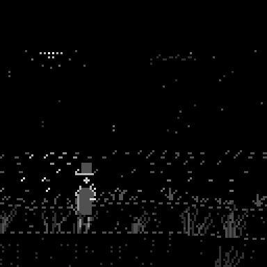

# Szary (chili-gray-ascii)

A short noir detective story for the ChiliChip **VGC Zero** (RP2350, 128x128), drawn only with ASCII characters in shades of grey. Built on the [chili-chip fork of the 32blit SDK](https://github.com/chili-chip/32blit-sdk); it also runs on desktop (SDL) and in the browser.

**Status: technical test (M0).** One night scene, not a game yet. It answers two questions before we build the story: does ASCII grass in the wind look good on a 128x128 screen, and is it fast enough on the console?



## The idea

Wydma, a small Baltic seaside town in November, off-season. The lighthouse went dark at 22:40 and the keeper is gone. Detective Szary has one night. Five short chapters (about an hour in all): walk the beach, the pier, the dunes and the old bunker, look at things with the torch, talk to people, then put the answer together on a deduction board. Polish and English.

The wind is part of the case: grass that lies **against** the wind was stepped on, so it shows where someone walked.

## What the test shows

- Dunes at night: stars, a moon of dots, clouds and a dark lighthouse far away, the sea, two layers of dunes and grass in front of the detective.
- Grass in tufts. Every blade is a small spring pushed by the wind at its own place, and gusts travel across the dunes, so you see a wave go through the grass.
- The torch lights the grass, the sand and the dust in its beam. The fire in Halina's barrel lights her and leans with the wind.
- A trail of flattened grass to look at (clue), and a short talk with Halina.
- A dialog box drawn with ASCII, typed out letter by letter, with Polish letters.

## Controls

| Button | Action |
|---|---|
| D-pad left / right | Walk |
| A | Look / talk / next line |
| Y | Torch on or off |
| X | Polish / English |
| B | Show the frame rate and how long a frame takes to draw (for testing on the console) |

On a PC: arrow keys, `Z` = A, `X` = B, `C` = X, `V` = Y.

## How it draws

- **Text font:** 3x5 capitals in a 4x7 cell, so 32 characters fit on a line. Row 0 holds the Polish accents and row 6 the ogonek (`font.cpp`).
- **Micro font:** 2x3 marks (`. : - ' ~ _ |`) for far things, like the dots in an ASCII-shaded picture.
- Characters are placed on any pixel, not on a grid, so movement is smooth (one pixel at a time).
- Eight greys, 0 = black (the OLED pixel is off).
- Glyphs are drawn as horizontal spans straight into the screen with the surface's blend function, not pixel by pixel.
- `wind.hpp` has the wind field and the grass springs with no drawing, so the self-test can run them.

## Build

The SDK is expected next to this folder (`../32blit-sdk`) or in `PATH_32BLIT_SDK`.

```bash
# desktop (Linux: libsdl2-dev libsdl2-image-dev libsdl2-net-dev; pip install 32blit "bitstring<5")
cmake -B build -D32BLIT_DIR=../32blit-sdk
cmake --build build
./build/chili-gray-ascii.elf

# VGC Zero (.uf2)
cmake -B build-vgc -D32BLIT_DIR=../32blit-sdk -DPICO_SDK_PATH=../pico-sdk -DPICO_BOARD=chilichip_vgc \
  -DPICO_PLATFORM=rp2350-arm-s -DCMAKE_TOOLCHAIN_FILE=../32blit-sdk/pico2.toolchain
cmake --build build-vgc
```

### Self-test and clips

`-DGRAY_SELFTEST=ON` (desktop only) also builds `gray-ascii-selftest`, a headless run of the real game code:

```bash
cmake -B build-test -D32BLIT_DIR=../32blit-sdk -DGRAY_SELFTEST=ON
cmake --build build-test --target gray-ascii-selftest
./build-test/gray-ascii-selftest               # checks, exits 1 on a failure
./build-test/gray-ascii-selftest --clip DIR 4  # scripted walk, one PPM every 4 updates (25 fps)
./build-test/gray-ascii-selftest --bench       # render time on this machine
```

It checks that every text has a glyph for every character and fits the box, that the wind never blows backwards and brings gusts, that free grass leans with the wind and pressed grass against it, that the picture has only greys, and a walk through the scene (intro, trail, torch, language, talk, no walking during a talk, a long stall).

Make the GIF from a clip: `ffmpeg -framerate 25 -i DIR/f%05d.ppm -vf "scale=384:384:flags=neighbor" szary.gif`.

## Next

1. Measure the frame rate on a console (B shows it). The goal is a steady 30 fps or more.
2. If it is fast enough: chapter 1 in full (M1). If not: a faster glyph blitter in RAM.

## Licence

MIT, see [LICENSE](LICENSE). The font, art, story and code are original.
