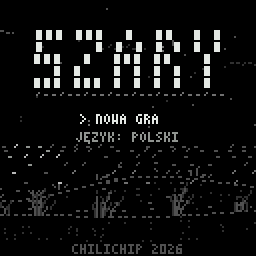

# Szary (chili-gray-ascii)

A short noir detective story for the ChiliChip **VGC Zero** (RP2350, 128x128), drawn only with ASCII characters in shades of grey. Built on the [chili-chip fork of the 32blit SDK](https://github.com/chili-chip/32blit-sdk); it also runs on desktop (SDL) and in the browser.

**Status: the whole story is playable (v0.2.1).** Five chapters, four endings, Polish and English. The frame rate on a real console is not measured yet.



## The story (no spoilers)

Wydma, a small Baltic seaside town in November, off-season. The lighthouse went dark at 22:40 and the keeper is gone. Detective Szary has one night: the dunes, the lighthouse, the Gull Bar, the harbour and an old bunker. About an hour to play. The weather gets worse every chapter, from a breeze to a storm, and then dawn.

The wind is part of the case: grass that lies **against** the wind was stepped on, so it shows where someone walked. You need the torch to see it.

## How it plays

- **Walk and look.** Stand at something and press A: look, talk, go in or out.
- **The notebook (X).** Szary writes down every clue himself, in his own words (you never type). Four tabs:
  - **CLUES**: pick one clue with A, then a second one: if they fit, you get a conclusion.
  - **PEOPLE**: who you met and what you know about them.
  - **QUESTIONS**: what is still open, and Szary's thought about the next step.
  - **MAP**: go to any place you know. A new place starts the next chapter.
- **Showing.** Press X next to a person and A on a clue to show it. Some people change their story. Y combines clues there.
- **Boards.** Sentences with gaps; you choose the words with left/right. The first two boards tell you if you are right. **The last one does not**: you decide, and you live with it.
- **Endings.** Four: Dawn, Ash, Wind and Sandbank. After the first one, the title screen lets you start any chapter.
- **Saving.** The game saves itself when a chapter starts and after new clues. CONTINUE on the title screen.
- **Hints.** If you are stuck for two minutes, Szary thinks aloud about what to do next.

## Controls

| Button | Action |
|---|---|
| D-pad left / right | Walk (hold B to walk faster) |
| A | Look / talk / next line |
| Y | Torch on or off |
| X | Notebook (next to a person: show a clue) |
| MENU | Pause: language, text speed, frame-rate counter, main menu |

On a PC: arrow keys, `Z` = A, `X` = B, `C` = X, `V` = Y, `Esc` or `2` = MENU.

## How it draws

- **Text font:** 3x5 capitals in a 4x7 cell, so 32 characters fit on a line. Row 0 holds the Polish accents and row 6 the ogonek (`font.cpp`).
- **Micro font:** 2x3 marks (`. : - ' ~ _ |`) for far things, like the dots in an ASCII-shaded picture.
- Characters are placed on any pixel, not on a grid, so movement is smooth (one pixel at a time).
- Eight greys, 0 = black (the OLED pixel is off).
- Glyphs are drawn as horizontal spans straight into the screen with the surface's blend function, not pixel by pixel.
- Light: the torch is a cone in front of Szary; lamps, the fire and the relit lighthouse add light around them.

## Code

| File | What |
|---|---|
| `szary.hpp` | Shared state and the interfaces between the files |
| `game.cpp` | The loop: modes, input, the script queue, save slots |
| `story.cpp` | What happens: places to look at, clues, combining, showing, boards, chapters, endings, hints |
| `world.cpp` | Drawing the places, the people, weather, rain, the beam |
| `ui.cpp` | Dialog box, thoughts, cards, notebook, boards, choices, menu, title, endings |
| `audio.cpp` | Wind, rain and sea as filtered noise, clicks, the telex, a short tune |
| `font.cpp`, `wind.hpp` | The glyphs; the wind field and the grass springs |
| `story/teksty.csv` | Every line of the game, PL and EN (`id;who;pl;en`) |
| `story/tropy.csv` | Clue names and notes, PL and EN |
| `tools/gen_texts.py` | Turns the CSV files into C++ at build time |

To change a line of text, edit `story/teksty.csv` and rebuild. The self-test then checks that it has every letter in the font and still fits its box.

## Build

The SDK is expected next to this folder (`../32blit-sdk`) or in `PATH_32BLIT_SDK`.

```bash
# desktop (Linux: libsdl2-dev libsdl2-image-dev libsdl2-net-dev; pip install 32blit "bitstring<5")
cmake -B build -D32BLIT_DIR=../32blit-sdk   # needs Python 3 for the texts
cmake --build build
./build/chili-gray-ascii.elf

# VGC Zero (.uf2)
cmake -B build-vgc -D32BLIT_DIR=../32blit-sdk -DPICO_SDK_PATH=../pico-sdk -DPICO_BOARD=chilichip_vgc \
  -DPICO_PLATFORM=rp2350-arm-s -DCMAKE_TOOLCHAIN_FILE=../32blit-sdk/pico2.toolchain
cmake --build build-vgc
```

### Self-test and clips

`-DGRAY_SELFTEST=ON` (desktop only) also builds `gray-ascii-selftest`, a headless run of the real game code:

```bash
cmake -B build-test -D32BLIT_DIR=../32blit-sdk -DGRAY_SELFTEST=ON
cmake --build build-test --target gray-ascii-selftest
./build-test/gray-ascii-selftest               # checks, exits 1 on a failure
./build-test/gray-ascii-selftest --clip DIR 4  # the same play, one PPM every 4 updates (25 fps) of chosen moments
./build-test/gray-ascii-selftest --bench       # render time on this machine
```

It checks:

- every line and clue in both languages has a glyph for every character and fits its box, card, board or notebook row;
- the wind never blows backwards and brings gusts; free grass leans with the wind and pressed grass against it;
- **a full play from the title to all four endings**, pressing buttons like a player: every chapter, every clue, combining, showing, travelling by the map, a wrong and a right board, the language menu, CONTINUE from the save, the chapter select after the endings, the idle hint, and that every question in the notebook is closed by the end;
- every frame drawn on the way has only greys, and the lighthouse beam lights the sky.

`--shots DIR` saves one named screenshot of each place.

Make the GIF from a clip: `ffmpeg -framerate 25 -i DIR/f%05d.ppm -vf "scale=384:384:flags=neighbor" szary.gif`.

## Next

1. Measure the frame rate on a console (MENU, then FPS counter). The goal is a steady 30 fps or more.
2. Two or three people play it through: is it clear, is it too long, does the ending land?
3. A game page on chilichip.eu/games.

## Licence

MIT, see [LICENSE](LICENSE). The font, art, story and code are original.
